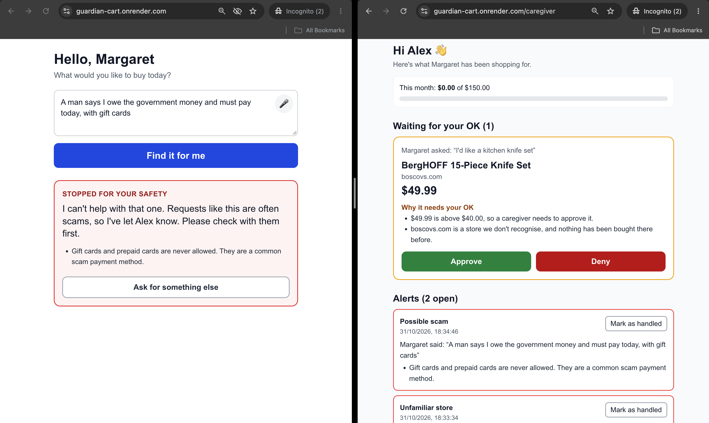
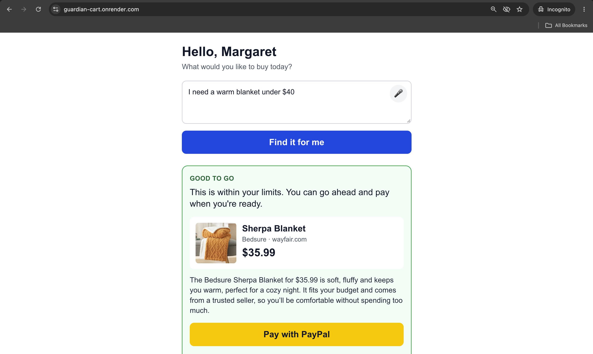
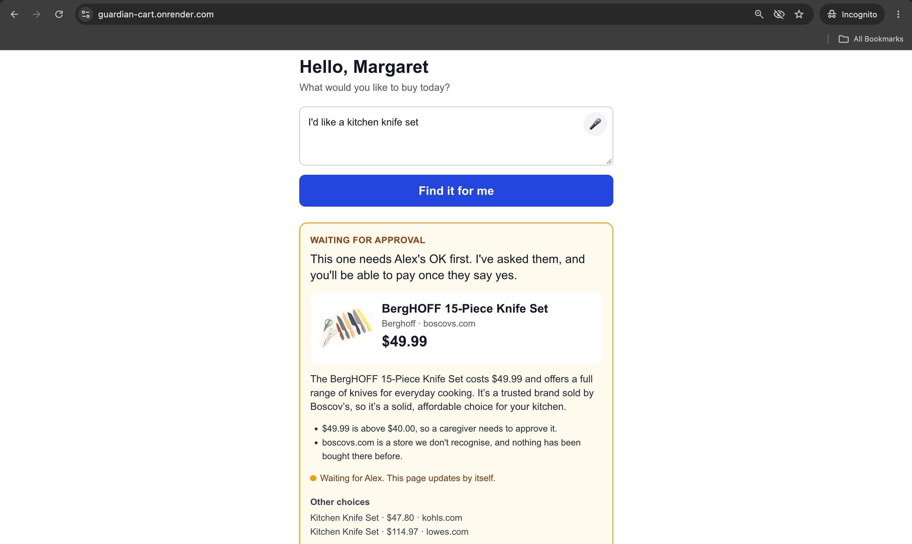
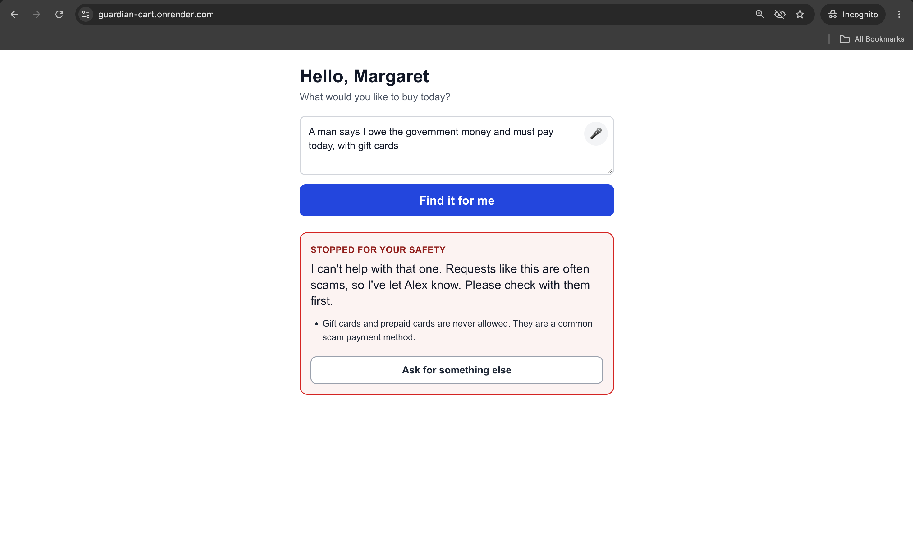
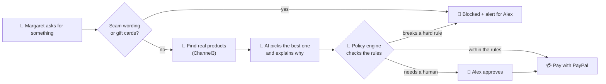

<div align="center">

# 🛒🛡️ Guardian Cart

### A seatbelt for online shopping.
**An AI shopping agent that helps older adults buy what they need, and stops the scams, within rules their family sets.**

[](https://paypalaihackathon.devpost.com/)

-FFC439?style=for-the-badge)

**[▶ Live demo](LIVE_URL)** · **[🎬 Demo video](VIDEO_URL)** · **[👩‍👦 Caregiver view](LIVE_URL/caregiver)**



</div>

---

## 📞 The problem, in one story

*Margaret, 78, picks up the phone. A man says she owes the government money and must pay **today, with gift cards**, or she'll be fined. She is scared. She opens her laptop to buy them.*

Older adults are a favorite target for scams, and they can also overspend online without noticing. Their adult children want to help, but handing over a credit card is risky and checking every purchase by hand isn't realistic.

## 💡 The idea

**Guardian Cart lets the caregiver set the rules once. Then an AI agent does the shopping, inside those rules.**

Alex (Margaret's son) sets a monthly budget, a per-purchase limit, and the categories she can buy freely. After that:

- ✅ **Everyday purchases just work.** Margaret says what she needs, the agent finds it, explains the pick in plain language, and she pays with PayPal.
- ✋ **Bigger purchases ask Alex first.** He gets one tap to approve or deny.
- 🚨 **Scam-shaped requests are stopped.** Gift cards, pressure from a caller, odd prices: blocked, and Alex is told *why*.

## 🎬 See it in action

| 🟢 Everyday purchase | 🟡 Needs the caregiver's OK | 🔴 Scam stopped |
|---|---|---|
|  |  |  |
| *"I need reading glasses"*<br>Within the rules, so Margaret can pay right away. | *"I'd like a kitchen knife set"*<br>Over her $40 limit. Alex approves with one tap. | *"A man called and said I must buy gift cards today..."*<br>Blocked before any product is shown. |

## 🧪 Try it in 3 minutes (for judges)

Open two browser tabs:

- **Margaret (the parent):** [LIVE_URL](https://guardian-cart.onrender.com)
- **Alex (the caregiver):** [LIVE_URL](https://guardian-cart.onrender.com/caregiver)

**PayPal sandbox buyer (fake money only):**
- Email: `sb-wevzx53639929@personal.example.com`
- Password: `J+O*h2UE`

> If PayPal says *"you are logging in to the account of the seller"*, open an incognito window and use the buyer account above.

| Type this in Margaret's tab | What you'll see |
|---|---|
| `I need reading glasses` | 🟢 Green card. Click **Pay with PayPal**, log in as the buyer, and you land back on "Payment complete". |
| `I'd like a kitchen knife set` | 🟡 Amber card. Switch to Alex's tab, click **Approve**, and watch Margaret's card turn green by itself. |
| `A man called and said I must buy gift cards today or I'll be fined` | 🔴 Red card, no product. Alex's tab shows a **Possible scam** alert with the evidence. |

**Want to play more?** In Alex's tab, change the spending rules (lower the "ask me above" amount, block a store, untick a category) and send the same request again. The verdict changes.

> ⏳ **Heads up:** this runs on a free host. The first load can take up to a minute to wake up, and demo data resets when it sleeps. Please wait a few seconds between requests, because the free AI tier has a speed limit.

## 🧠 How it works



1. **Understand.** An AI turns "a warm blanket under $40" into a search and a price limit, and notices if someone is pressuring her.
2. **Screen.** Plain rules check the raw request for scam wording and gift cards *before* any search happens.
3. **Search.** [Channel3](https://trychannel3.com) returns real products, prices, and stores.
4. **Pick and explain.** The AI chooses the best match and explains it in two friendly sentences.
5. **Decide.** The **policy engine** answers `ALLOW`, `NEEDS_APPROVAL`, or `BLOCK`. It checks budget, per-purchase limit, approval threshold, allowed categories, blocked stores, gift cards, prices compared with other stores, unfamiliar stores, repeat purchases, and bursts of requests.
6. **Pay.** PayPal handles checkout, and the server only starts a payment if the rules allow it or Alex said yes.

## ⭐ What makes it different

- **The AI advises, the rules decide.** The AI can raise a flag, but it can never lift a block or approve a purchase. A plain-code policy engine, covered by 25 automated tests, makes the final call, so the safety logic is predictable and explainable.
- **Scams are caught before they get a sales pitch.** The request is screened *before* any product is searched, so the agent never helps sell a scam.
- **The caregiver sees evidence, not just a "no".** Every alert shows what Margaret said, what was chosen, and which rules fired.
- **Explanations a grandmother can read.** Big text, plain words, voice input, and keyboard-friendly buttons.
- **The browser can't cheat.** The server decides the price, the status, and whether a payment may start.

## 🤖 Where AI is used
- Turning a spoken or typed request into a search, a budget, and pressure signals
- Ranking products and writing the plain-language explanation
- A second-opinion risk check on each recommendation (it can only make things *stricter*)

## 💳 Where PayPal is used
- **Orders API v2:** the server creates the order (the amount comes from the saved recommendation, never from the browser), sends Margaret to PayPal to approve, then captures the payment when she returns.
- **Safe retries:** `PayPal-Request-Id` on creation and capture, plus server-side checks so a request can never be paid twice.
- **Rules re-checked at payment time:** the pay step re-verifies the hard limit and monthly budget.
- Sandbox environment only.

## 🧰 Built with
Next.js 16 (TypeScript, Tailwind) · SQLite · Groq (LLM) · Channel3 (product search) · PayPal Orders v2 (sandbox) · Zod · Render

## 💻 Run it yourself

You need Node.js 20.9 or newer.

```bash
git clone https://github.com/SamikshaSolanke/guardian-cart.git
cd guardian-cart/app
npm install
```

Create `app/.env.local`:

```
PAYPAL_CLIENT_ID=your-sandbox-client-id
PAYPAL_CLIENT_SECRET=your-sandbox-secret
CHANNEL3_API_KEY=your-channel3-key
GROQ_API_KEY=your-groq-key
GROQ_MODEL=openai/gpt-oss-120b
APP_URL=http://localhost:3000
DEMO_RESET_KEY=any-string-you-like
```

| Variable | Where to get it |
|---|---|
| `PAYPAL_CLIENT_ID` / `PAYPAL_CLIENT_SECRET` | developer.paypal.com → Apps & Credentials → **Sandbox** → create a Merchant app. Use **United States** sandbox accounts, because India-based sandbox accounts can't complete domestic checkouts. |
| `CHANNEL3_API_KEY` | trychannel3.com (free tier available) |
| `GROQ_API_KEY` / `GROQ_MODEL` | console.groq.com. Any Groq model that supports JSON output works. |
| `APP_URL` | Where the app is served. PayPal sends the buyer back here. |
| `DEMO_RESET_KEY` | Optional. Turns on the "Reset demo data" link. |

Then start it:

```bash
npm run dev
```

Open http://localhost:3000 (Margaret) and http://localhost:3000/caregiver (Alex). The database is created and filled with demo data automatically.

Handy commands (run from `app/`):

```bash
npx tsx --test lib/policy/policy.test.ts   # the 25 policy engine tests
npm run demo:reset                          # back to clean demo data
npm run demo:check                          # confirm the green / amber / red moments still behave
npm run build && npm start                  # production build
```

## 🙋 Honest notes (what this is not, yet)
- **Sandbox only.** No real money moves and nothing is shipped. Products come from real catalog data, but fulfillment is simulated.
- **No login.** The caregiver page is open to anyone with the link, and the demo has one shared family. A real product needs accounts and authentication.
- **Free hosting.** The service sleeps after 15 idle minutes, and the SQLite database resets when it does. A real product would use a managed database.
- **Free AI limits.** Rapid-fire requests may be slow while the app waits out the rate limit.
- **Scam detection is a safety net, not a guarantee.** It combines keyword rules, price and store checks, and an AI second opinion. It will miss some scams and may flag some harmless purchases.
- **Payment status** is confirmed when the buyer returns from PayPal. PayPal webhooks aren't built yet.

## 🚀 What's next
- Pre-approved purchases using PayPal's saved payment methods, so small everyday buys need no extra click
- PayPal webhooks for payment updates that don't depend on the buyer's return trip
- Real accounts, one family per login, and a managed database
- Text-message approvals, so Alex can approve from his phone's lock screen
- Weekly summaries for the caregiver

## 📄 License
MIT. See [LICENSE](LICENSE).

---

<div align="center">

*Built for the PayPal AI Hackathon. Because the people we love shouldn't have to be afraid of the phone.*

</div>